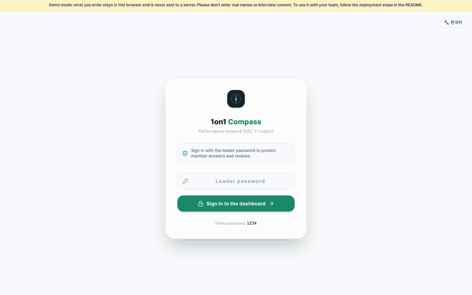
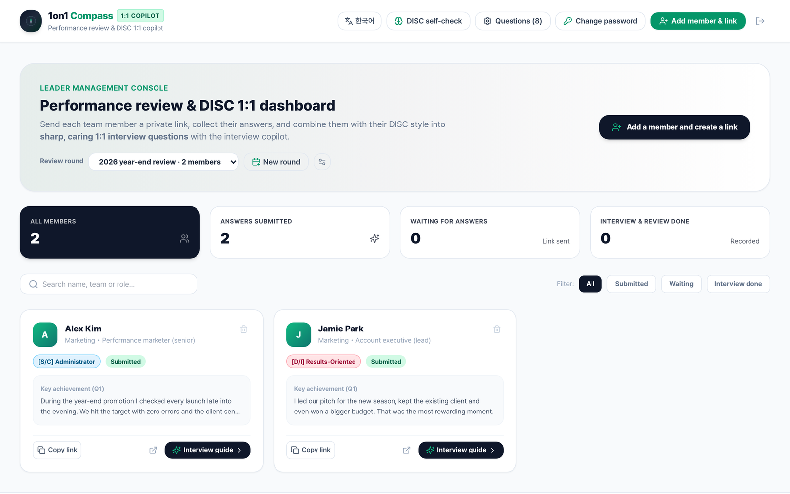
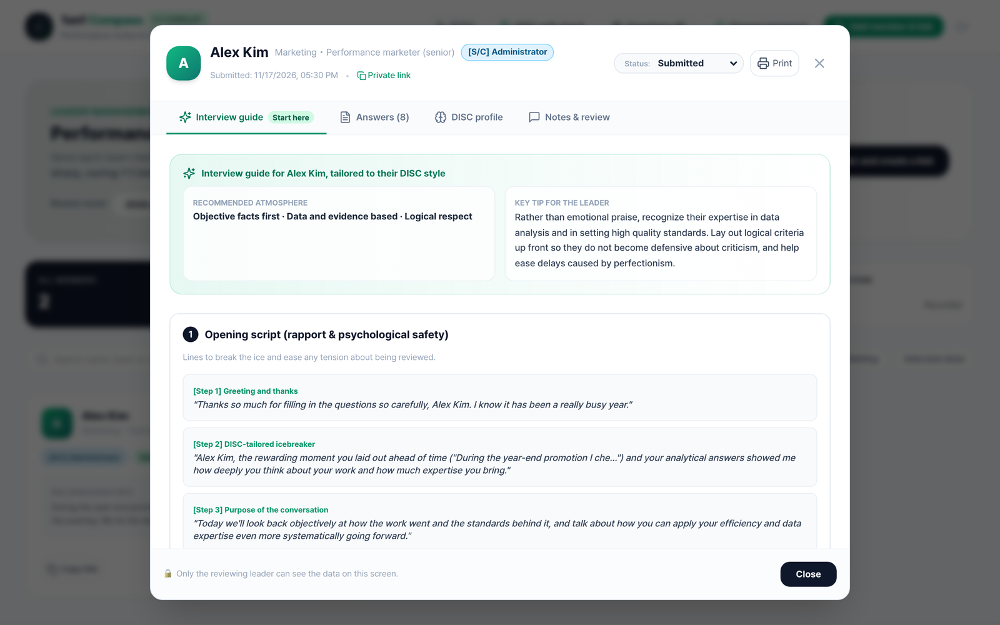
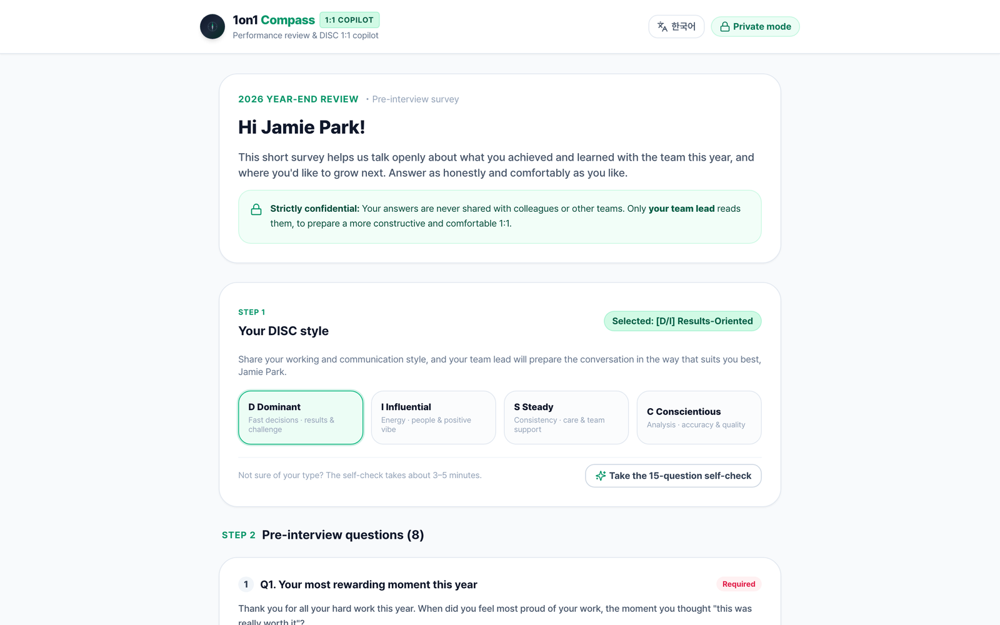

# 1on1 Compass

A pre-1:1 survey and interview copilot for team leads. Send each team member a private link, collect their reflections and DISC profile before the meeting, and get a conversation guide tailored to how that person communicates.

**[Try the live demo →](https://1on1-compass-demo.vercel.app/)** (demo password `1234`; data stays in your browser) &nbsp; [](https://vercel.com/new/clone?repository-url=https%3A%2F%2Fgithub.com%2FGreycity1988%2F1on1-compass&project-name=1on1-compass&env=LEADER_PIN&envDescription=First+leader+password+%288%2B+characters%29.+Connect+Upstash+Redis+under+Storage+after+deploying.&envLink=https%3A%2F%2Fgithub.com%2FGreycity1988%2F1on1-compass%23deploy-your-own-vercel--upstash-redis)



> Available in English and Korean: the app follows the browser language, and a toggle switches it. [한국어 안내 →](README.ko.md)

## What it does

- **Private survey links.** Each member gets a link with a random 128-bit token. The link opens only that member's survey: they cannot see anyone else or the leader's notes.
- **Editable questions.** Eight default questions on achievements, blockers, collaboration, growth and support needs. Edit, add or remove them in the dashboard.
- **DISC self-check.** Members either take a 15-question self-assessment or pick their type directly.
- **Interview guide.** For each submission the dashboard builds an opening script, follow-up questions, coaching prompts and do's and don'ts based on the member's answers and DISC type. The guide is generated by rules in the browser. No answers are sent to an AI service.
- **Review rounds.** Run it every season: name each round (e.g. "2026 year-end review"), start the next one with the same members and questions, close old rounds, and see each person's past answers, notes and action items when preparing the next 1:1.
- **Interview notes.** Notes, action items, a grade and comments stay on the leader's side and are never shown on the member's link.

## Screenshots

| Leader dashboard | DISC-tailored interview guide | Member's private survey |
|---|---|---|
|  |  |  |

## How data is protected

| | |
|---|---|
| Leader password | Stored only as a salted scrypt hash on the server and checked there. It is never sent to the browser. |
| Sign-in | Gives a signed session that lasts 12 hours. Changing the password signs out every session. |
| Failed sign-ins | Limited to 10 per IP address and 100 in total per 15 minutes. |
| Member list, notes, grades | Returned only to a signed-in leader. |
| Member link | Can read and submit only its own answers. Answers lock once the interview starts. |
| Storage | One record per member, so saves don't overwrite each other. |
| Links and headers | Pages are sent with `Referrer-Policy: no-referrer`, so a member's link is not passed to other sites. They also carry a strict Content Security Policy and cannot be embedded in other sites. |

Anyone with a member's link can open that member's survey, so share links privately.

## Quick start (local demo)

```bash
npm install
npm run dev            # http://localhost:5177
```

Without a server and database the app runs in **local demo mode**:
- Data stays in that browser and the demo password is always `1234` (it can't be changed in demo mode).
- Sample members are included.
- Member links work only in the same browser.

Use it to try the app, not to run a real team.

## Deploy your own (Vercel + Upstash Redis)

1. Fork this repository and import it in [Vercel](https://vercel.com/new). The framework preset is Vite.
2. In the Vercel project, open **Storage → Marketplace → Upstash Redis** and connect a database (the free tier is enough). This adds the `KV_REST_API_URL` and `KV_REST_API_TOKEN` variables.
3. Add an environment variable **`LEADER_PIN`** with your first password (8 or more characters).
4. Redeploy. Sign in, then change the password from the dashboard (**비밀번호 변경**).

After the first sign-in the password lives in the database as a hash. `LEADER_PIN` is used only while no password has been stored yet, so you may remove it afterwards.

Each deployment serves one team and one leader. Deploy separately for each team.

### Running a public demo

Deploy the repository as a separate Vercel project **without** connecting a database, and add `DEMO_MODE=true`. The API then refuses to store anything, even if a database gets connected later by mistake, and the app runs in demo mode in each visitor's browser.

### Environment variables

| Name | Required | Purpose |
|---|---|---|
| `KV_REST_API_URL`, `KV_REST_API_TOKEN` (or `UPSTASH_REDIS_REST_URL`, `UPSTASH_REDIS_REST_TOKEN`) | yes | Upstash Redis connection |
| `LEADER_PIN` | first deploy | Initial leader password |
| `DEMO_MODE` | no | `true` for a public demo: the API never stores data |
| `VITE_FEEDBACK_ISSUES_URL` | no | Where the footer's feedback link opens a new GitHub issue |
| `VITE_DONATION_URL` | no | Coffee link in the footer |

## Development

```bash
npm run dev        # front end only (local demo mode)
npx vercel dev     # front end + API, reads .env.local (see .env.example)
npm test           # API tests on an in-memory store
npm run typecheck  # front end and API
npm run build
```

```
api/               Vercel functions: auth.ts, config.ts, members.ts, _lib/server.ts
src/components/    React screens (dashboard, member survey, modals)
src/utils/api.ts   API client and server/local mode detection
src/utils/storage.ts   default questions and local demo storage
src/utils/aiGenerator.ts   rule-based interview guide
src/data/discData.ts       DISC types and patterns
tests/             API tests
```

## Feedback

Ideas and bug reports are welcome in [Issues](../../issues). Please don't post real member names or interview content there: issues are public.

## License

[MIT](LICENSE). Use, modify and share it freely, including commercially.

Part of the Marketing Intelligence Suite, made by Owen O. Magnus.
